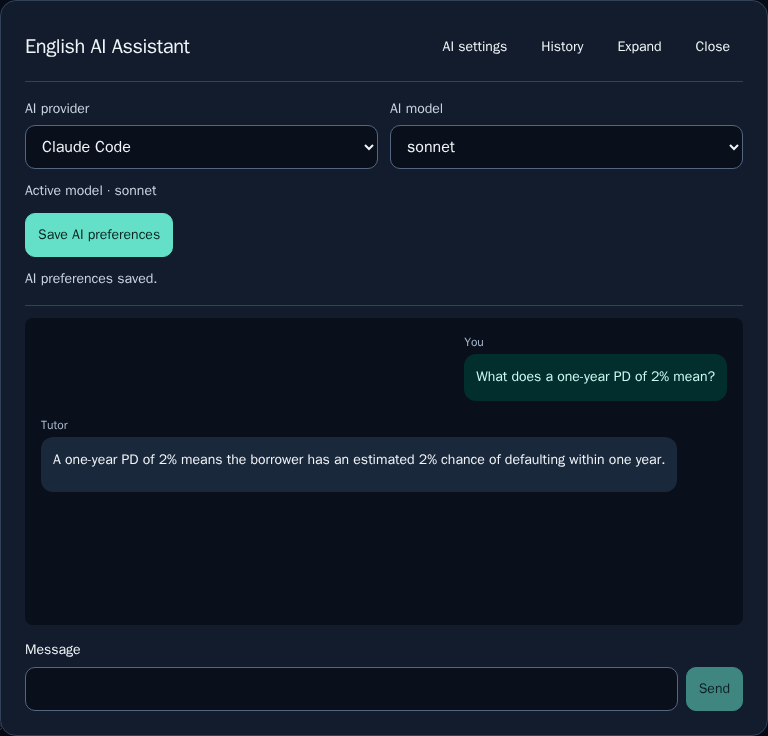
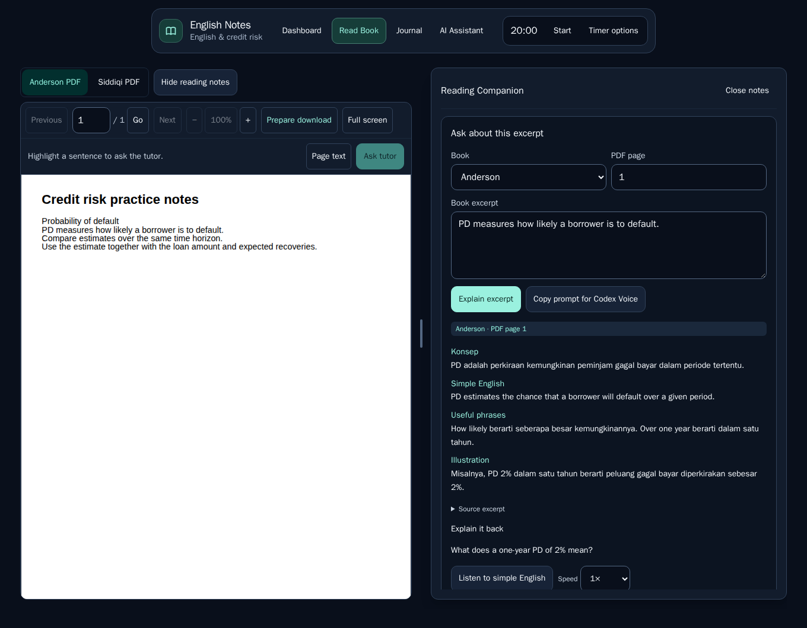
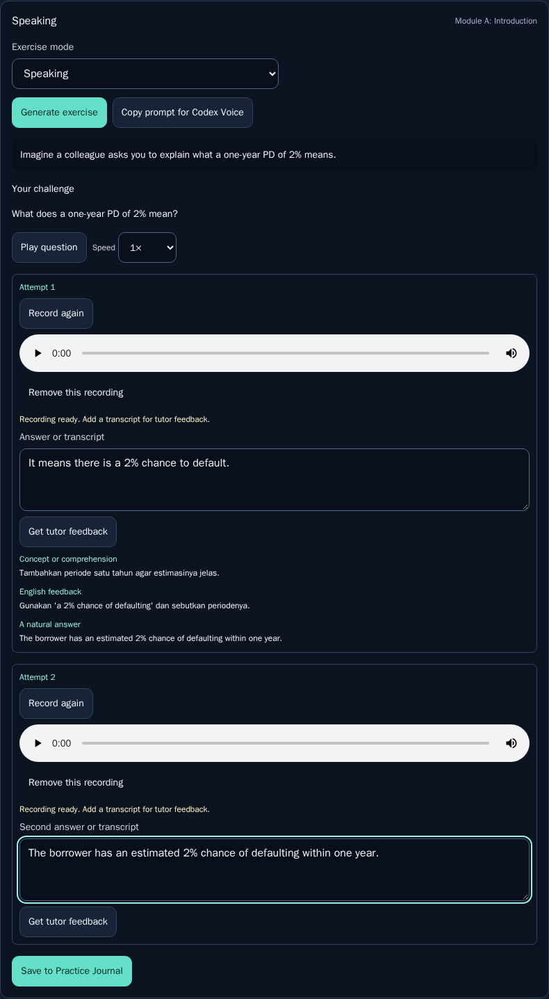
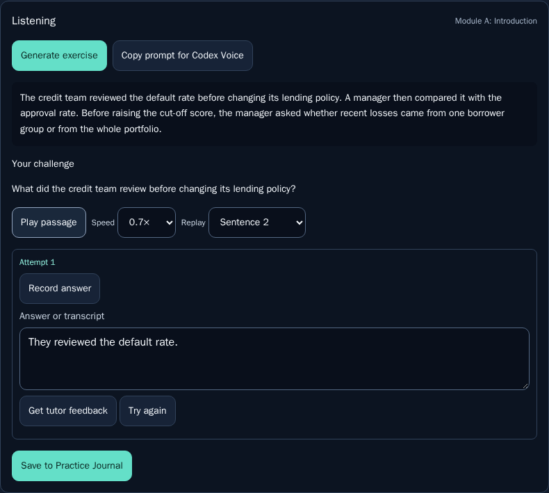
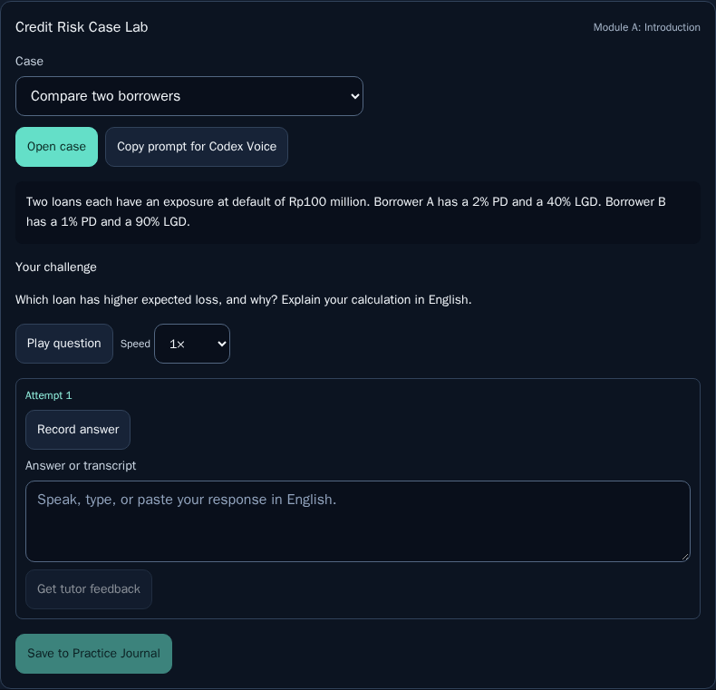
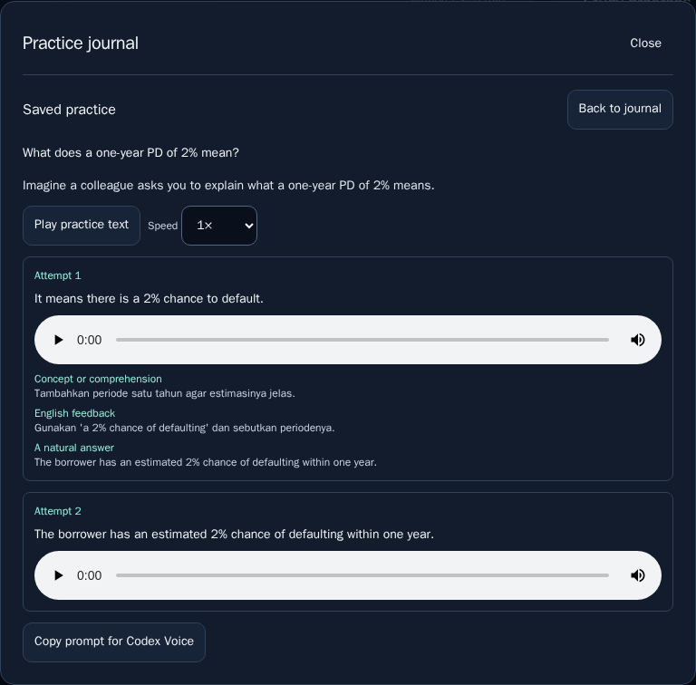
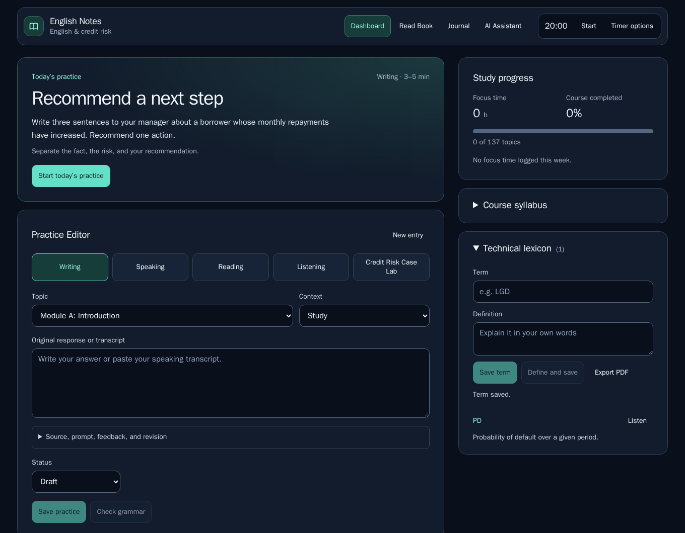

# Panduan English Notes

Mulai dari **Today’s practice** di Dashboard untuk latihan singkat, atau pilih kegiatan sesuai tujuanmu.

| Saya mau… | Buka |
| --- | --- |
| Memahami kalimat di buku | [Read Book → Ask tutor](#membaca-buku-dengan-tutor) |
| Melatih grammar dan menulis jawaban kerja | [Dashboard → Practice Editor → Writing](#menulis-dan-memperbaiki-grammar) |
| Melatih speaking, listening, atau interview | [Practice Editor → Speaking atau Listening](#latihan-speaking-dan-listening) |
| Melatih logika credit risk | [Practice Editor → Credit Risk Case Lab](#credit-risk-case-lab) |
| Membuka latihan lama dan mencoba lagi | [Journal](#meninjau-latihan-di-journal) |
| Memilih Codex atau Claude Code | [AI Assistant → AI settings](#memilih-tutor-ai) |
| Mencatat durasi dan kosakata | [Study timer, Study progress, dan Technical lexicon](#waktu-progres-dan-kosakata) |

Tangkapan layar di halaman ini diambil dari English Notes versi `31ddbbe` dengan PDF, jawaban tutor, dan rekaman uji. Nama model pada gambar adalah contoh pilihan.

## Memilih tutor AI

1. Buka **AI Assistant → AI settings**.
2. Pilih **Codex** atau **Claude Code** di **AI provider**. Pilih opsi yang tersedia di **AI model**, lalu klik **Save AI preferences**.
3. Cek **Active model**. Pilihan tersebut dipakai untuk tutor kutipan, feedback latihan, grammar, definisi istilah, dan percakapan di Assistant.

Workspace Tencent memakai login langganan yang sudah terhubung di server. Daftar model mengikuti metadata koneksi provider. **Gemini · setup pending** menandakan koneksi Gemini masih perlu disiapkan.

Coba tulis di **Message**.

> Explain the difference between PD and LGD in simple English. Give me one example and ask me a follow-up question.

Buka **History** di Assistant untuk melihat interaksi AI sebelumnya. Latihan yang kamu simpan dibuka lewat **Journal**.

## Membaca buku dengan tutor

1. Buka **Read Book**, lalu pilih **Anderson PDF** atau **Siddiqi PDF**. Klik **Study reader** bila sedang memakai tampilan PDF bawaan browser.
2. Sorot kalimat, lalu klik **Ask tutor**. Nama buku, nomor halaman PDF, dan kutipan masuk ke **Reading Companion**. Dengan keyboard, buka **Page text**, pilih bagian yang ingin dibahas, lalu klik **Use selected text**. Kamu juga bisa membuka **Reading notes** dan mengisi sumber serta menempelkan kutipan sendiri.
3. Klik **Explain excerpt** untuk melihat penjelasan konsep dalam bahasa Indonesia, versi **Simple English**, frasa penting, dan ilustrasi. **Listen to simple English** membacakan versi Inggrisnya jika suara perangkat tersedia.
4. Jawab pertanyaan **Explain it back** dengan mengetik atau merekam jawaban dan mengisi transkrip. Klik **Get tutor feedback** untuk mengecek konsep dan bahasa. **Save to Practice Journal** menyimpan latihan beserta sumbernya.

Contoh pertanyaan dari kutipan tentang PD.

> What does a one-year PD of 2% mean?

Jawaban yang bisa kamu ucapkan.

> It means the borrower has an estimated 2% chance of defaulting within one year.

Untuk mencatat pertanyaan yang akan dibahas nanti, buka **Other reading tools**, isi **Reading note**, lalu pilih **Save question to journal**. **Explain note** memberikan penjelasan singkat jika AI tersedia.

Di layar kecil, gunakan **Back to PDF** untuk melanjutkan membaca. **Open PDF tab** membuka PDF dalam tab terpisah.

## Menulis dan memperbaiki grammar

1. Pilih **Writing** di **Practice Editor**, lalu pilih **Topic** dan **Context**. **Start today’s practice** juga mengisi prompt berdasarkan latihan harian.
2. Tulis di **Original response or transcript**, lalu klik **Check grammar** jika AI aktif. Hasilnya memuat koreksi, versi yang lebih natural, dan penjelasan.
3. Klik **Copy feedback and correction to this entry**. Buka **Source, prompt, feedback, and revision** untuk mengedit hasilnya, lalu pilih **Save practice**.

| Contoh jawaban | Contoh revisi |
| --- | --- |
| The borrower have higher monthly repayments. I suggest to review the cash flow forecast. | The borrower has higher monthly repayments. I suggest reviewing the cash flow forecast. |

## Latihan speaking dan listening

### Speaking

1. Pilih **Speaking**, tentukan **Topic** dan **Context**, lalu klik **Generate exercise**.
2. Klik **Play question**. Jawab lewat **Record answer**, izinkan akses mikrofon, lalu hentikan rekaman dan putar ulang.
3. Isi atau koreksi **Answer or transcript**, lalu klik **Get tutor feedback**. **Concept or comprehension** membahas isi jawaban. **English feedback** membahas grammar, pilihan kata, atau kejelasan. **A natural answer** memberi contoh jawaban.
4. Klik **Try again** dan coba terapkan satu koreksi. **Save to Practice Journal** menyimpan kedua percobaan jika kamu mengisinya.

Pada simulasi ini, jawaban pertama menyebut peluang 2% dan tutor meminta periode waktunya. Pada percobaan kedua, pembicara menambahkan *within one year*.

Di **Exercise mode**, ada dua variasi latihan.

- **Shadowing**. Klik **Play model sentence**, tirukan ritme serta penekanan, lalu putar rekamanmu. Coba kalimat *The analyst explained the credit score in plain English*.
- **Role-play**. Pilih **Credit risk interviewer** atau **Senior risk analyst**. Setelah mendapat feedback, klik **Continue role-play** untuk menerima pertanyaan lanjutan seperti *Does a lower PD always mean a lower expected loss?*

### Listening

1. Pilih **Listening → Generate exercise → Play passage**. Dengarkan penjelasan sambil melihat pertanyaannya. Coba jawab dari ingatan.
2. Setelah mengisi jawaban atau merekam, buka **Reveal transcript**. Turunkan **Speed** dan gunakan **Replay** untuk mengulang satu kalimat.
3. Klik **Get tutor feedback** untuk mengecek pemahaman. Coba lagi dan simpan latihan jika ingin membandingkan hasilnya.

Pemutaran menggunakan suara Inggris di perangkat. Jika suara tersebut belum tersedia, pilih **Read instead** pada latihan Listening. Jika perangkat mendukung dikte lokal dan paket bahasa Inggrisnya sudah terpasang, transkrip dapat terisi otomatis. Kamu bisa mengetik atau menempelkan transkrip kapan saja.

Tutor mengevaluasi transkrip. Untuk pengucapan dan intonasi, bandingkan suara contoh dengan rekamanmu. Saat kamu memilih **Save to Practice Journal**, rekaman ikut disimpan di workspace.

### Melanjutkan latihan di Codex Voice

Klik **Copy prompt for Codex Voice** di tutor atau **Journal → Study details**. Tempel prompt ke sebuah task di aplikasi desktop ChatGPT, lalu pilih **Start voice chat** jika tersedia. Prompt dapat membawa topik, kutipan dan halaman buku, pertanyaan, transkrip percobaan, serta feedback yang sudah ada. Percakapan suara berlangsung di aplikasi desktop.

## Credit Risk Case Lab

Dalam contoh ini, **PD** adalah peluang gagal bayar, **LGD** adalah persentase kerugian saat gagal bayar, dan **EAD** adalah nilai eksposur saat gagal bayar.

1. Pilih **Credit Risk Case Lab → Compare two borrowers → Open case**.
2. Bandingkan kedua peminjam. Tulis atau ucapkan perhitungan dan alasanmu dalam bahasa Inggris.
3. Klik **Get tutor feedback**, lalu buka **Case reasoning** untuk membandingkan penalaranmu dengan pembahasannya. Simpan ke **Journal** jika ingin mengulang kasusnya.

Lihat pembahasan setelah mencoba

Expected loss = PD × LGD × EAD. Peminjam A menghasilkan 2% × 40% × Rp100 juta = **Rp800.000**. Peminjam B menghasilkan 1% × 90% × Rp100 juta = **Rp900.000**.

> Borrower B has the higher expected loss because its LGD is much higher, despite its lower PD.

Dua skenario lainnya membahas dampak menaikkan **approval cut-off** dan dampak perbaikan **recoveries** setelah gagal bayar.

## Meninjau latihan di Journal

- Buka **Journal** dan cari kata di topik, jawaban, atau feedback. Di **Filters and export**, saring berdasarkan skill, konteks, status, dan tanggal. Ekspor hasil ke CSV atau unduh satu latihan dengan **Download Markdown**.
- Klik **Study details** untuk melihat sumber, transkrip, feedback dan memutar rekaman yang tersimpan. Untuk menyunting catatan manual, klik **Open entry**.
- Pilih **Review now** pada latihan atau **Review practice** di atas daftar. Tulis jawaban dari ingatan, lalu klik **Reveal previous feedback**. Pilih **I remembered** atau **Try again tomorrow** untuk menjadwalkan review berikutnya, dalam WIB.

## Waktu, progres, dan kosakata

| Fitur | Cara menggunakan |
| --- | --- |
| **Study timer** | Buka **Timer options → Set duration**, tutup panel, lalu klik **Start**. Pakai **Pause** dan **Resume** untuk menjeda dan melanjutkan. Setelah minimal satu menit, catat sesi lewat **Timer options → Stop & Save**. |
| **Course syllabus** | Buka modul dan centang topik yang selesai. **Study progress** menunjukkan persentase topik selesai dan jam yang tercatat oleh timer. |
| **Technical lexicon** | Isi **Term** seperti *LGD* dan **Definition** dengan kata-katamu sendiri, lalu klik **Save term**. **Define and save** meminta AI menjelaskan istilah dan menyimpannya. **Listen** membacakan istilah dan **Export PDF** mengunduh daftar yang sudah disimpan. Lexicon juga tersedia di Reading Companion. |

