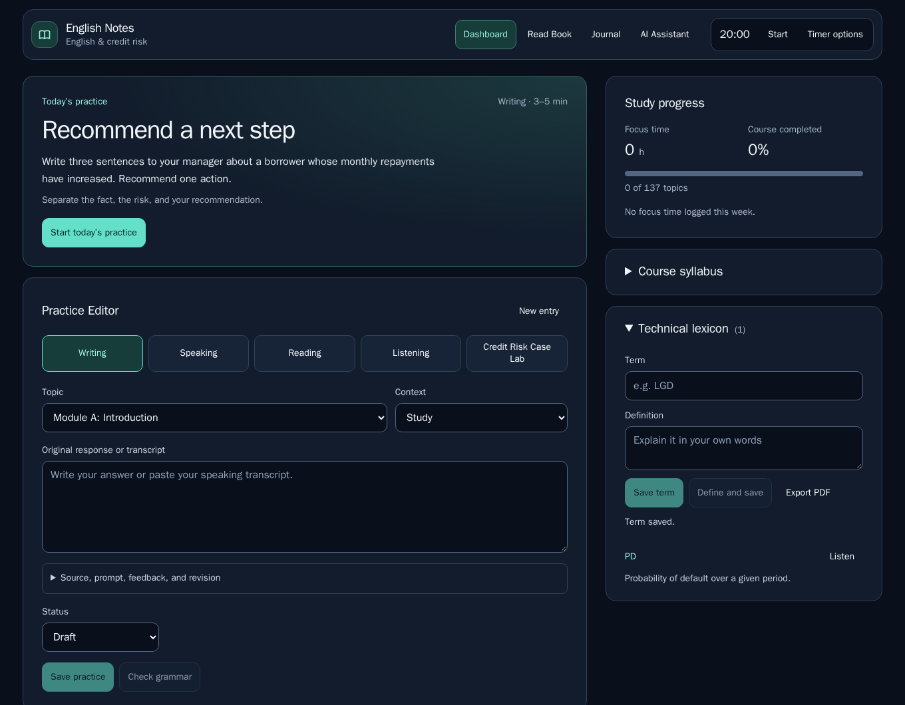

# English Notes

Belajar bahasa Inggris lewat topik credit risk. Baca buku Anderson atau Siddiqi, jelaskan konsep dengan kata-katamu sendiri, lalu simpan latihan untuk ditinjau lagi.

**[Panduan fitur, tangkapan layar, dan simulasi latihan](English_Tracker_App/docs/PANDUAN_FITUR.md)** · [Cara menjalankan aplikasi](English_Tracker_App/README.md)

